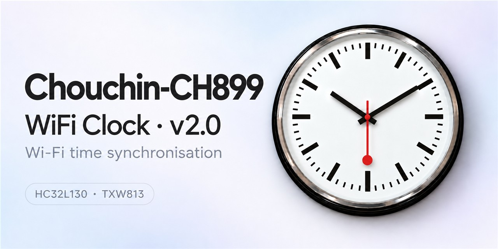
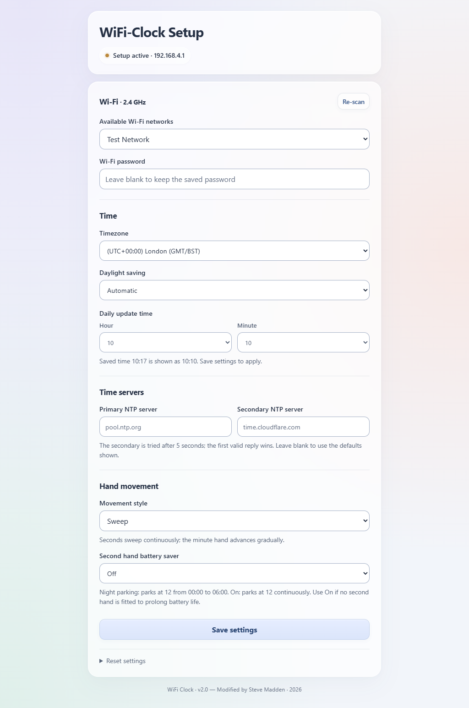

# CH899 · HC32 clock upgrade · v2.0

**For the newer clock board with “HC32” printed on its main chip.** This project adds movement styles, seconds-hand battery saving and a local settings page. It replaces the clock's movement and Wi-Fi software.

## Other clock projects

| Other repository | Choose it if… |
| --- | --- |
| [**MM32 — Wi-Fi only**](https://github.com/maddenste/Chouchin-CH899-Firmware) | Your chip says MM32 and you want to keep the factory hand movement |
| [**MM32 — clock upgrade**](https://github.com/maddenste/Chouchin-CH899-MM32-ESP8285) | Your chip says MM32 and you want movement styles and seconds-hand parking |

## Check your board

Open the clock's movement cover and look for **HC32** on the large square chip, as shown below. [More board photos and identification help →](docs/HARDWARE.md#board-photographs)

Click the photo to enlarge it. If your board differs, check the identification guide before installing.

## What this upgrade adds

- **Three movement styles:** Sweep, Burst and the station-clock pause at 12. [Watch an example](https://youtube.com/shorts/2L59QxfKAD8).
- **Seconds-hand battery saving:** park it overnight or all day.
- **Phone-friendly settings:** Wi-Fi, timezone, automatic summer/winter time changes and daily time updates in ten-minute steps.

## Install

**[Start installation →](docs/GETTING_STARTED.md)**

Follow the Windows 11 guide in order. It covers the equipment, downloads and programming both chips, including a guided launcher for the Wi-Fi chip. No compiling is required.

**Already installed?** [Change settings](docs/USER_GUIDE.md) · [Get help](docs/TROUBLESHOOTING.md) · [Printable manual](docs/WiFi-Clock-User-Manual-v2.0.pdf)

If you find a bug, please [let me know](https://github.com/maddenste/Chouchin-899-latest-revision/issues).

See the settings page

---

Unofficial project · Modified by Steve Madden · 2026.

[Downloads and release notes](https://github.com/maddenste/Chouchin-899-latest-revision/releases/tag/v21) · [Background and technical notes](docs/BACKGROUND.md) · [License and credits](NOTICE.md) · [Third-party notices](THIRD_PARTY_NOTICES.md)
